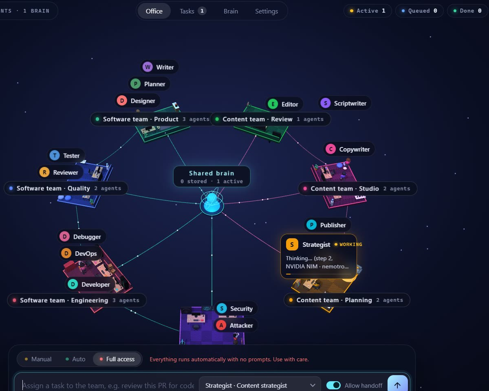

[中文说明](README.zh-CN.md)

# OrbitOffice

**Build your own AI office**

Imagine a software team, a marketing agency, or a content studio — you describe the work, and AI creates the office and the agents. Several departments can share one 3D world; the agents split the work, hand it off to each other, ask you when something is missing, and write real files into your folder.

## Build your own office
Build an office with AI in Settings → Offices & agents, or start from a ready-made template (software team, content team), or add one as a new department; every agent is an editable .md file (name, role, skills, which files it may write, instructions), and you can import agents from .md files.

## Use OrbitOffice from Claude Code and other AI tools (MCP)
OrbitOffice can run an MCP server so Claude Code, Claude Desktop, Cursor or any MCP client can list the agents, assign tasks, wait for results, read the files the agents wrote and chat with agents.

Turn it on in **Settings → Permissions**, click **Copy Claude Code setup** and paste it into a terminal. It looks like this:

```bash
claude mcp add --transport http orbitoffice http://127.0.0.1:47821/mcp --header "Authorization: Bearer <your key>"
```

Then just ask Claude Code, for example: *"Use OrbitOffice to get the Copywriter to write an Instagram caption for our new coffee."* The server only listens on your own computer and needs the key; anything that needs approval still asks you inside OrbitOffice.

## Shared brain
- **Project memory**: Every finished piece of work is recorded in the project folder. Before a new task, agents look up related earlier work and read the team's shared notes.
- **Skills library and skill store**: The brain holds the team's shared know-how as skills (same `SKILL.md` format as Claude skills). A built-in skill store offers ready-made skills in categories like development, content, marketing, office docs, and research.
- **Connector store with one-click sign-in**: One-click connectors for 33 services in seven categories — Supabase, Vercel, Netlify, Neon, Cloudflare, Canva, Notion, Linear, Atlassian, PayPal, Square and more. Sign-in happens once in your browser (through mcp-remote; needs Node.js). Actions that change things in an online account always ask first.

## AI pool
- **Your own free API keys stored encrypted on your computer**: Add API keys from several providers (Google Gemini, NVIDIA NIM, Groq, OpenRouter, a local Ollama, or any OpenAI-compatible endpoint). OrbitOffice tests every model, uses the strongest for real work and lighter ones for chat, and switches automatically when a quota runs out. Keys are stored encrypted on your computer and never shown in full.
- **Built-in local AI (Qwen3.5, Gemma 4, Granite; no key needed)**: No key and no internet needed: OrbitOffice checks your GPU, RAM and disk, recommends an open model that runs well on your machine (Qwen3.5, Gemma 4, Granite, each tested to call tools correctly), and downloads and runs it in one click. No Ollama required.

## Permission modes
- **Manual**: every task waits for your approval.
- **Auto**: routine tasks start by themselves; risky ones (deploy, release, delete) wait for approval.
- **Full access**: everything runs without prompts.

In every mode agents can only write inside the project folder; running commands must be switched on separately under Settings → Permissions; and publishing actions (git push, releases, deploys) always ask.

## Security team
OrbitOffice includes an Attacker (red team) that tests the project for vulnerabilities (only on targets you authorize, this project and localhost by default) and a Security engineer (blue team) who verifies the findings and fixes them, after which the Attacker retests.

## Download
Get the latest Windows installer from the [GitHub releases page](https://github.com/JTing904/OrbitOffice/releases/latest):
**OrbitOffice-Setup-0.1.0.exe** (not code‑signed yet — Windows SmartScreen may show a warning; click **More info**, then **Run anyway**).

## Website
Visit https://jting904.github.io/OrbitOffice/ for more information, screenshots, and documentation.

## Quick start
1. Download and run the installer.
2. Open **Settings → AI & connections**. Either enable **Local AI** (one click) or add a free API key from a provider.
3. In **Settings → General**, choose the folder the team should work in.
4. Type a task in the bar at the bottom, for example *"Plan and build a to‑do list web page"*, or open the chat and raise a topic.

## Build from source
Requires Node.js 18+ and Windows (the app itself is Electron, so macOS and Linux builds are possible but untested).
```bash
npm install
npm start                  # run in development
npm run dist              # build the installer in dist/installer/
npm run portable          # or a portable folder in dist/<name>/
```

## License
MIT

## Author
JTing904 on GitHub, @jtinnnng on Instagram