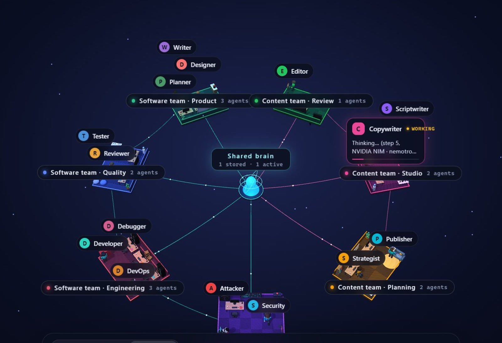

[English](README.md)

# OrbitOffice

**打造你自己的 AI 办公室**

软件团队、营销公司、内容工作室——你描述想要的团队，AI 就帮你搭好办公室和员工。几个部门可以待在同一个 3D 世界里；员工会分工、互相交接、缺资料时先问你，并且把真正的文件写进你的文件夹。

## 打造你的办公室
在 **设置 → 办公室与员工** 里用一句话让 AI 搭办公室，或从现成模板（软件团队、内容团队）开始，也可以把模板加成一个新部门。每个员工都是一个可以编辑的 .md 文件（名字、岗位、技能、能写哪些文件、工作说明），也可以从 .md 文件导入员工。

## 在 Claude Code 等 AI 工具里使用 OrbitOffice（MCP）
OrbitOffice 可以开一个 MCP 服务器，让 Claude Code、Claude Desktop、Cursor 或任何 MCP 客户端查看员工、派任务、等结果、读取员工写好的文件，以及和员工聊天。

在 **设置 → 权限** 里打开它，按 **「复制 Claude Code 设定」**，贴到终端执行就好，大概是这样：

```bash
claude mcp add --transport http orbitoffice http://127.0.0.1:47821/mcp --header "Authorization: Bearer <你的密钥>"
```

之后直接跟 Claude Code 说，例如：*「用 OrbitOffice 请 Copywriter 帮我们的新咖啡写一则 Instagram 贴文」*。服务器只在你自己的电脑上，而且要有密钥才连得上；需要批准的操作，照样在 OrbitOffice 里弹窗问你。

## 共享大脑
- **项目记忆**：每件做完的工作都会记在项目文件夹里。接新任务前，员工会先找相关的旧工作，并读团队的共享笔记。
- **技能库和技能商店**：团队的做事方法存成技能（和 Claude 技能一样的 `SKILL.md` 格式）。内置的技能商店有开发、内容、营销、办公文档、研究等类别的现成技能。
- **一键登录的连接器商店**：七大类共 33 个连接器——Supabase、Vercel、Netlify、Neon、Cloudflare、Canva、Notion、Linear、Atlassian、PayPal、Square 等。只要在浏览器登录一次（通过 mcp-remote，需要 Node.js）。会改动线上账号的操作，每次都会先问你。

## 你自己的 AI
- **用你自己的免费 API Key，加密存在你的电脑上**：可以加多家的 Key（Google Gemini、NVIDIA NIM、Groq、OpenRouter、本地 Ollama，或任何兼容 OpenAI 的接口）。OrbitOffice 会测试每个模型，真正干活用最强的，聊天用轻量的，额度用完会自动换。Key 加密保存在你的电脑上，界面里不会完整显示。
- **内置本地 AI（Qwen3.5、Gemma 4、Granite，不用 Key）**：不用 Key、不用联网。OrbitOffice 会检测你的显卡、内存和硬盘，推荐一个在你电脑上跑得顺的开源模型（每个都实测过能正确调用工具），一键下载就能用，不需要装 Ollama。

## 权限模式
- **手动**：每个任务都等你批准。
- **自动**：一般任务自己开始；有风险的（部署、发布、删除）等你批准。
- **完全访问**：全部自动进行，不再询问。

不管哪种模式，员工都只能在项目文件夹里写文件；运行命令要在 **设置 → 权限** 里另外打开；发布类操作（git push、发布 release、部署）每次都会问你。

## 安全团队
OrbitOffice 有一个攻击者（红队），只在你授权的目标上测漏洞（默认只有这个项目和本机 localhost）；还有一个安全工程师（蓝队）负责核实并修好问题，修完后攻击者会再测一次。

## 下载
到 [GitHub 发布页](https://github.com/JTing904/OrbitOffice/releases/latest) 下载最新的 Windows 安装档：
**OrbitOffice-Setup-0.1.0.exe**（目前还没有代码签名，Windows SmartScreen 可能会跳警告：点「更多信息」→「仍要运行」）。

## 网站
https://jting904.github.io/OrbitOffice/ 有更多介绍和截图。

## 快速开始
1. 下载并运行安装档。
2. 打开 **设置 → AI 与连接**，一键启用 **本地 AI**，或加上一家 AI 的免费 API Key。
3. 在 **设置 → 通用** 选择团队要工作的文件夹。
4. 在底部的任务栏输入任务，例如 *「规划并做一个待办事项网页」*，或打开聊天跟员工讨论。

## 从源码构建
需要 Node.js 18+ 和 Windows（App 基于 Electron，理论上也能构建 macOS 和 Linux 版，但没有测试过）。
```bash
npm install
npm start                  # 开发模式运行
npm run dist              # 在 dist/installer/ 生成安装档
npm run portable          # 或在 dist/<name>/ 生成免安装版
```

## 许可证
MIT

## 作者
GitHub：JTing904 ・ Instagram：@jtinnnng
